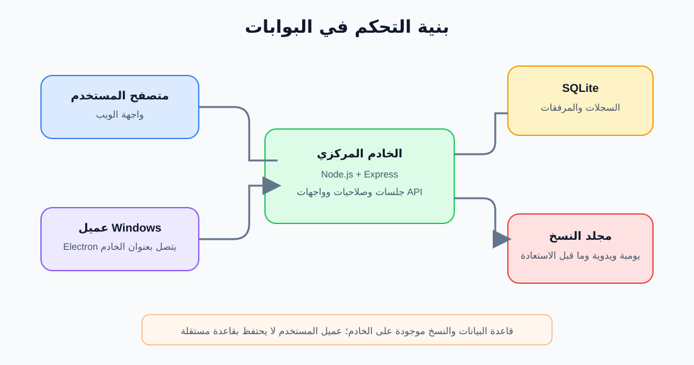

# دليل المسؤول والتشغيل

## 1. مكونات النظام

يتكون النظام من خادم Node.js وواجهة ويب ثابتة وقاعدة بيانات SQLite. يمكن تشغيل واجهة المشغّل في المتصفح أو داخل عميل Electron. كما يمكن تشغيل تطبيق Windows منفصل يستضيف الخادم المركزي ويخدم الأجهزة الأخرى على الشبكة المحلية.



## 2. تشغيل نسخة التطوير على Windows

### المتطلبات

- Windows.
- Node.js 22.12 أو أحدث وnpm.
- الوصول إلى مجلد المشروع.

### البدء

```powershell
npm install
npm start
```

افتح `http://localhost:3000` على الجهاز نفسه. إذا كان الاستخدام من أجهزة أخرى، استخدم عنوان IP لجهاز الخادم والمنفذ `3000`، وتأكد من السماح بالاتصال الوارد في جدار حماية Windows على شبكة موثوقة. لا توصل الخادم مباشرة بالإنترنت دون تصميم نشر آمن ومراجعة أمنية.

عند أول دخول، أنشئ حساب المدير. صفحة الإعداد الأولي تتوقف عن إنشاء مدير جديد بعد وجود حساب مستخدم في قاعدة البيانات.

### أوامر المشروع

| الأمر | الاستخدام |
|---|---|
| `npm start` | تشغيل خادم الويب باستخدام Node.js |
| `npm run desktop` | تشغيل عميل Electron الذي يتصل بخادم محدد |
| `npm run desktop:server` | تشغيل نافذة خادم Electron للاستضافة المركزية |
| `npm run build:css` | بناء ملف CSS المصغر |
| `npm run package:desktop` | بناء حزمة Windows المحمولة لعميل سطح المكتب |
| `npm run package:server` | بناء حزمة Windows المحمولة للخادم المركزي |

تُكتب مخرجات الحزم في `release` للعميل و`release-server` للخادم وفق الإعدادات الحالية.

## 3. عميل سطح المكتب وخادم Windows

### العميل

العميل ليس قاعدة بيانات محلية مستقلة. عند تشغيله لأول مرة، أدخل عنوان الخادم، مثل `http://192.168.1.10:3000`. تحفظ بيانات النظام على الخادم المركزي. يمكن تغيير العنوان لاحقًا من قائمة التطبيق.

### الاستضافة عبر تطبيق الخادم

1. شغّل `Gate-Control-Server` على الجهاز الذي سيستضيف البيانات.
2. اترك نافذة حالة الخادم مفتوحة؛ إغلاقها يوقف الخادم.
3. استخدم أحد عناوين الشبكة المعروضة في النافذة لإعداد تطبيقات المستخدمين.
4. اسمح للتطبيق في جدار حماية Windows ضمن الشبكة الخاصة فقط حسب سياسة الجهة.
5. إذا كان المنفذ الافتراضي مشغولًا، اختر منفذًا بديلًا في نافذة الخادم وأعد اتصال العملاء باستخدام العنوان والمنفذ الجديدين.

يخزن تطبيق الاستضافة ملف قاعدة بياناته في مجلد بيانات تطبيق Windows، ويسجل سجل تشغيل الخادم داخل مجلد `logs` هناك. هذا يختلف عن تشغيل `npm start` مباشرة، الذي يستخدم قاعدة البيانات في مجلد المشروع افتراضيًا.

## 4. إدارة الحسابات والصلاحيات

الأدوار المعروفة هي **مدير** و**مشغّل**:

| الوظيفة | المدير | المشغّل |
|---|---:|---:|
| تسجيل العمليات اليومية | نعم | نعم |
| إدارة بيانات الأفراد والمركبات والقوائم والفرق | نعم | لا |
| إدارة حسابات المستخدمين وتفعيلها | نعم | لا |
| عرض المكاتبات | جميع المكاتبات | المكاتبات التي أنشأها أو أُسندت إليه |
| تعديل أوقات السجلات | جميع السجلات المدعومة | السجلات التي أنشأها فقط |
| إنشاء/استعادة نسخ قاعدة البيانات | نعم | لا |
| حذف بعض السجلات الإدارية | نعم | لا |

من تبويب المستخدمين:

1. أنشئ اسم مستخدم من 3 إلى 32 حرفًا إنجليزيًا صغيرًا أو رقمًا أو نقطة أو شرطة أو شرطة سفلية.
2. عيّن كلمة مرور لا تقل عن 8 أحرف.
3. حدد الاسم الظاهر والدور، ثم احفظ.
4. عطّل الحساب بدل مشاركة كلمة المرور أو ترك حساب غير مستخدم نشطًا.

لا يستطيع المدير تعطيل حسابه الحالي أو إزالة صلاحية المدير عنه عبر صفحة الإدارة. كلمات المرور لا تحفظ كنص صريح؛ تستخدم مشتقات scrypt مع قيمة عشوائية لكل كلمة مرور. يحد تسجيل الدخول محاولات الفشل مؤقتًا.

## 5. بيانات الإدارة والقوائم

### الأفراد

أدخل الاسم والرقم العسكري والرتبة. الرقم العسكري فريد. يمكن إضافة الوحدة ورقم الهاتف، وتحديد الضابط المتقاعد. ينبغي أن تكون رتبة المتقاعد من فئة الضباط. لا تحذف فردًا لديه سجلات تاريخية إلا بعد فهم أثر الحذف على العلاقات والسجلات.

### المركبات

أدخل رقم اللوحة ونوع المركبة والغرض، وأضف بيانات السائق/المرافق إذا كانت مطلوبة. اللوحة فريدة. قوائم نوع المركبة والغرض مرتبطة بقسم القوائم.

### الفرق

أنشئ اسم الفرقة وتاريخ البداية والنهاية، ثم أضف الأفراد من إدارة أعضاء الفرقة. تبدأ عمليات تسجيل الحضور والغياب من صفحة العمليات، ولا تقبل تواريخ خارج فترة الفرقة.

### القوائم المنسدلة

يمكن للمدير إضافة أو إزالة عناصر مثل الوحدة ونوع المركبة والغرض والوجهة وسبب الزيارة والبوابة. يؤثر التغيير في النماذج التي تستخدم القائمة. تجنب حذف قيمة ما زالت لازمة لسير العمل.

## 6. النسخ الاحتياطي والاستعادة

- عند بدء الخادم، يتحقق النظام من وجود نسخة يومية لذلك اليوم؛ كما يعيد التحقق دوريًا أثناء عمل الخادم. إذا لم توجد نسخة لليوم، ينشئ واحدة.
- يمكن للمدير إنشاء نسخة يدوية قبل التغييرات المهمة.
- تُحفظ النسخ في مجلد `backups` بجوار قاعدة البيانات عند التشغيل العادي، أو بجوار مسار قاعدة البيانات الذي تحدده إعدادات التشغيل.
- يحتفظ النظام بآخر 30 نسخة مع حماية نسخة ما قبل الاستعادة أثناء العملية.
- قبل الاستعادة، ينشئ النظام حفظًا للحالة الحالية، ثم يتحقق من سلامة النسخة المختارة. الاستعادة تستبدل قاعدة البيانات الحالية، وتحتاج بعدها إلى تسجيل الدخول مجددًا.

### إجراء استعادة موصى به

1. نسّق لإيقاف إدخال البيانات مؤقتًا.
2. تحقق من تاريخ النسخة وحجمها من صفحة النسخ الاحتياطي.
3. اختر **استعادة** وأكد العملية بعد قراءة التنبيه.
4. أعد تسجيل الدخول، وافحص المستخدمين والسجلات والتاريخ المطلوب.
5. لا تحذف مجلد النسخ أو تنقله أثناء النسخ أو الاستعادة.

للنسخ الخارجي أو النقل اليدوي، استخدم ميزة النسخ الاحتياطي من داخل النظام. لا تنسخ ملف SQLite أثناء عمل الخادم باستخدام مستكشف الملفات؛ قاعدة البيانات تعمل بوضع WAL وقد توجد بيانات لازمة في ملفات `-wal` و`-shm`.

## 7. تخزين البيانات وحدود الحماية

- قاعدة البيانات الأساسية SQLite. المسار الافتراضي عند تشغيل `npm start` هو `gate.db` في مجلد المشروع، ويمكن تغييره بمتغير البيئة `GATE_DB_PATH`.
- مسار النسخ الافتراضي هو مجلد `backups` بجوار قاعدة البيانات، ويمكن تغييره بمتغير `GATE_BACKUP_DIR`.
- يمكن تغيير منفذ الخادم بمتغير `PORT`؛ الافتراضي `3000`.
- مرفقات المكاتبات تحفظ داخل قاعدة البيانات كبيانات BLOB، وتُحمى بإجراءات الدخول والصلاحيات على مستوى التطبيق.
- **لا تعتبر قاعدة البيانات أو النسخ أو المرفقات مشفرة على القرص في التطبيق الحالي.** حماية جهاز الخادم ومجلد البيانات والنسخ الاحتياطية وصلاحيات Windows مسؤولية تشغيلية مهمة. لا ترسل النسخ أو المرفقات إلى خدمات خارجية غير معتمدة.
- اتصال الإعداد الافتراضي يستخدم HTTP. استخدمه فقط على شبكة داخلية موثوقة. عند الحاجة إلى اتصال عبر شبكة غير موثوقة، انشر خلف HTTPS مع إعدادات موثوقة ومراجعة أمنية.
- ملفات قاعدة البيانات وسجلات WAL والنسخ الاحتياطية بيانات تشغيلية، ولا ينبغي إضافتها إلى Git أو تضمينها في الحزم المنشورة.

## 8. التقارير وتعديل السجلات

تتيح الواجهة تقرير اليوم والطباعة، وتقارير الحركة والتصدير. تتوفر صيغ CSV أو Excel وفق القسم. عند تصحيح التاريخ/الوقت:

- التعديل محصور في أنواع الحقول المسموح بها؛ لا يسمح بتغيير حقول قاعدة البيانات العامة.
- يرفض النظام تواريخ غير صالحة أو ترتيبًا زمنيًا غير منطقي لبعض الأحداث.
- يتطلب تعديل الحضور وقوعه ضمن مدة الفرقة، ويمنع تكرار حضور الشخص في اليوم نفسه عند تغيير التاريخ.
- المشغّل لا يعدل إلا سجلاته، ويستطيع المدير تعديل السجلات المدعومة كافة.

## 9. استكشاف الأعطال

| العرض | ما يجب التحقق منه |
|---|---|
| لا يفتح `localhost:3000` | تأكد من أن نافذة الخادم تعمل، وأن المنفذ غير مستخدم، وافحص رسالة الطرفية أو سجل الخادم. |
| العميل لا يتصل بالخادم | تحقق من عنوان IP والمنفذ، وأن الخادم لا يزال يعمل، وأن الجهازين على شبكة يمكنها التواصل، وأن جدار الحماية يسمح بالاتصال. |
| تظهر رسالة أن المنفذ مستخدم | أوقف الخدمة الأخرى التي تستخدمه أو اختر منفذًا بديلًا في الخادم، ثم حدّث عناوين العملاء. |
| لا يظهر سجل أو لا يسمح بتعديله | تحقق من التاريخ المختار، ومن أن حالته لم تُغلق مسبقًا، ومن أن حسابك هو من سجل السجل أو اطلب من المدير المساعدة. |
| استعادة نسخة لم تنجح | لا تحذف نسخة ما قبل الاستعادة. احتفظ برسالة الخطأ وسجل الخادم، وأوقف محاولات الاستعادة المتكررة حتى التحقق من سلامة النسخة. |
| النسخة اليومية لا تظهر | يجب أن يعمل الخادم كي ينفذ التحقق اليومي؛ راجع صلاحية الكتابة في مجلد النسخ، والمساحة المتاحة، ورسائل الخادم. |
| تطبيق العميل لا يعرض الصفحة بعد البناء | أعد بناء CSS عبر `npm run build:css` ثم أعد حزمة Windows. |

## 10. للمطورين

- نقطة تشغيل الخادم: `server.js`.
- واجهة العمليات: `public/index.html`.
- واجهة الإدارة: `public/admin.html`.
- صفحة الدخول: `public/login.html`.
- عميل Electron: `desktop/main.js`.
- مشغّل/واجهة خادم Electron: `desktop/server-main.js` وما يرتبط به من ملفات `desktop/server-*`.
- يعتمد التطبيق على Express وbetter-sqlite3 وExcelJS، مع Electron وTailwind CSS لبناء تطبيقات سطح المكتب والواجهة.
- ينفذ الخادم إنشاء الجداول والترقيات اللازمة عند التشغيل. خذ نسخة احتياطية قبل اختبار ترقية على بيانات فعلية.

## 11. حدود الوثائق

هذه الوثائق تصف السلوك الموجود في الشيفرة عند إعدادها. تحقق من واجهة الإصدار المنشور إذا اختلفت أسماء الأزرار أو خطوات التشغيل بعد تحديث التطبيق. لا تتضمن الوثائق شرحًا لكل مسار API أو ضمانًا للامتثال لمعايير تشغيلية أو أمنية خارجية.
