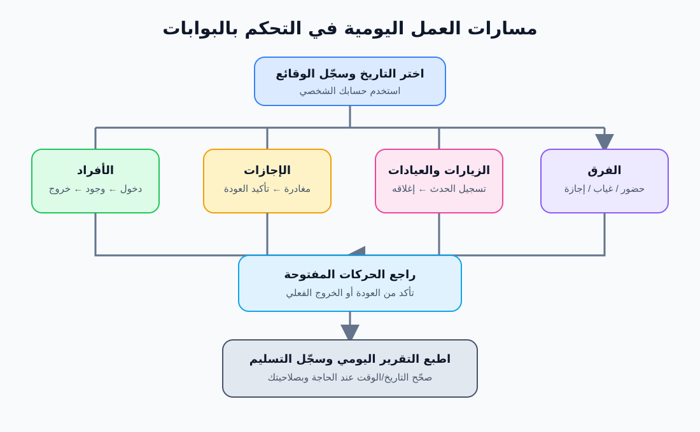

# دليل المستخدم

## 1. نظرة عامة

يُستخدم «التحكم في البوابات» لتسجيل الوقائع التشغيلية ومراجعتها حسب التاريخ. تُحفظ السجلات في قاعدة بيانات SQLite على جهاز الخادم المركزي؛ تطبيق سطح المكتب على جهاز المشغّل يتصل بالخادم ولا ينشئ قاعدة مستقلة.

- للاطلاع على عرض موجز للوظائف وأمثلة ولقطات مناسبة للتقديم للإدارة، راجع [عرض النظام للإدارة](./عرض-النظام-للإدارة.md).

## 2. تسجيل الدخول

1. افتح رابط النظام أو تطبيق Windows.
2. أدخل اسم المستخدم وكلمة المرور اللذين أنشأهما مسؤول النظام.
3. عند أول تشغيل فقط، تظهر صفحة إعداد النظام لإنشاء حساب المدير الأول.
4. استخدم «تسجيل الخروج» عند الانتهاء، خصوصًا على جهاز مشترك.

حساب المشغّل مخصص للأعمال اليومية. حساب المدير مسؤول عن بيانات التهيئة وإدارة الحسابات والنسخ الاحتياطية وبعض إجراءات الحذف.

### استخدام الواجهة

- على الشاشات الصغيرة، افتح القائمة من زر ☰؛ أغلقها باختيار قسم، أو بالضغط على الخلفية، أو بمفتاح Escape.
- زر 🌙/☀️ يبدّل الوضع الداكن والفاتح، ويُحفظ الاختيار على الجهاز نفسه.
- إذا لم يسبق اختيار الوضع، يتبع النظام إعداد المظهر في الجهاز.

## 3. الصفحة الرئيسية ولوحة اليوم

تُظهر لوحة اليوم ملخصًا تشغيليًا للتاريخ المختار، مثل أعداد الأفراد وحالتهم داخل الوحدة، والحركات المفتوحة، والزائرين، والعيادات، والمأموريات، والمركبات، وحضور الفرق والتكليفات التي لم يؤكد المستخدم استلامها.

- غيّر التاريخ لعرض ملخص يوم آخر عند توفر محدد التاريخ.
- تحقّق من الحركات المفتوحة قبل إقفال اليوم؛ قد تعني حركة مفتوحة أن تسجيل العودة أو الانصراف لم يكتمل.
- الإقفال/التسليم اليومي يجمع ملخص اليوم وملاحظاته لتسهيل التسليم بين المناوبات. راجع الملخص قبل حفظه أو طباعته.

## 4. الأفراد وحركة الدخول والخروج

تُسجل حركة الفرد عند حدوثها، وليس باعتبار أن جميع الأفراد يحتاجون إلى إثبات حضور يومي.

1. اختر الفرد من قائمة الأفراد المسجلين مسبقًا، ثم سجّل الدخول.
2. عند مغادرته، سجّل الخروج من سجل الحركة أو من إجراء الخروج المتاح.
3. يظل الفرد الذي لم يُسجّل خروجه ظاهرًا باعتباره موجودًا، حتى في الأيام التالية.
4. تظهر صفة النوبتجي للفرد خلال فترة التكليف المسجلة، ولا يلزم إعادة إدخاله يوميًا لمجرد استمراره داخل الوحدة.
5. الجنود العائدون من الإجازة يُسجل رجوعهم من سجل الإجازة؛ لا يلزم إنشاء خروج فوري لهم.

إضافة الأفراد أو تعديل بياناتهم (الاسم، الرقم العسكري، الرتبة، الوحدة، وبيانات الاتصال) تتم من قسم الإدارة. فئات الرتب تشمل الجنود وصف الضباط والضباط والمدنيين، ويمكن تمييز الضباط المتقاعدين بصورة مستقلة.

### التمام اليومي للضباط المتقاعدين

في الإصدار الحالي، إجراء التمام اليومي المنفصل يخص الضباط المتقاعدين فقط. سجّل الحضور للتاريخ المطلوب، وألغِه إذا أُدخل بالخطأ. أما بقية الفئات فتعكس حركتها سجلات الدخول والخروج.

## 5. الإجازات

1. أنشئ سجل إجازة للفرد وحدد تاريخ بدايتها وموعد العودة المتوقع بالتاريخ والوقت، وأضف السبب عند الحاجة.
2. عند مغادرة الفرد فعليًا، استخدم إجراء **تسجيل الخروج للإجازة**. يسجل النظام وقت المغادرة وحركة الخروج المرتبطة بها.
3. عند عودته، استخدم **تأكيد العودة**. يسجل وقت العودة الفعلي وحركة الدخول، حتى لو تأخر عن الموعد المتوقع.
4. الإجازة التي لم تُؤكد عودتها تظل ظاهرة ضمن الحالات المفتوحة/المتأخرة حتى تسجيل الرجوع.
5. لتصحيح وقت مسجل، استخدم تعديل التاريخ والوقت إن كان متاحًا في تفاصيل السجل. التعديل لا يغني عن تسجيل الإجراء الفعلي (مغادرة أو عودة).

## 6. العيادات

1. اختر الفرد وسجل الحالة أو سبب الذهاب والجهة الطبية.
2. عند التسجيل، تُفتح حالة عيادة ويُحفظ وقت الذهاب.
3. عند عودته، استخدم **تسجيل العودة** لإغلاق الحالة وتسجيل وقت الرجوع.
4. راجع الحالات المفتوحة في لوحة اليوم؛ لا تُغلق الحالة بمجرد انقضاء اليوم.

## 7. الزيارات

1. اكتب اسم الزائر؛ قد يقترح النظام أسماء سبق تسجيلها. اختر الاسم السابق أو أكمل اسمًا جديدًا ليُحفظ ضمن السجلات.
2. اختر الرتبة من القائمة، وأدخل سبب الزيارة وأي بيانات إضافية يطلبها النموذج.
3. سجّل الزيارة عند الدخول، ثم استخدم إجراء **تسجيل الخروج** عند مغادرة الزائر.
4. تبقى الزيارة المفتوحة ظاهرة حتى تسجيل الخروج.
5. راجع وقت الدخول والخروج في قائمة الزيارات أو التقرير اليومي.

## 8. المركبات

تُسجل المركبات المعروفة مسبقًا من الإدارة، بما فيها اللوحة والنوع والغرض، والسائق والمرافق/الرتبة الأخرى حيثما يتيح النموذج ذلك.

- سجل الدخول والخروج للمركبة، وحدد الغرض أو الوجهة عند الطلب.
- يمكن تسجيل حركة مركبة زائرة غير معرفة في القائمة من نموذج الحركة اليدوي.
- تُستخدم تعيينات المركبات اليومية لتسجيل السائق والمرافق والركاب المخصصين للمركبة لذلك اليوم.
- راجع المركبات الموجودة داخل الوحدة والحركات غير المغلقة في لوحة اليوم.

## 9. الفرق وحضور الأفراد

ينشئ المدير الفرقة ويحدد بدايتها ونهايتها وأفرادها. بعد ذلك، يسجل المشغّل لكل فرد في تاريخ سريان الفرقة أحد الإجراءات:

- **حضور:** يسجل وقت الدخول. يمكن تسجيل الانصراف لاحقًا في اليوم نفسه.
- **غياب:** يسجل غيابًا صريحًا لذلك اليوم، ولا يمكن تسجيل حضور اليوم نفسه قبل إلغاء الغياب.
- **إلغاء الغياب:** يستخدم إذا أُدخل الغياب خطأ أو حضر الفرد.
- **لا حضور ولا غياب:** يُعامل اليوم على أنه إجازة/يوم غير مسجل كحضور أو غياب؛ ليس غيابًا صريحًا.

من سجل الشخص يمكن مراجعة مرات حضوره وسجلاته السابقة. يجب أن يقع تاريخ الحضور ضمن مدة الفرقة. يسمح النظام بسجل حضور واحد لكل فرد في الفرقة في اليوم الواحد.

## 10. المأموريات والنوبتجيات

### المأموريات

سجّل الفرد والوجهة وسبب/غرض المأمورية ووقت الخروج. عند عودته، استخدم إجراء العودة لإغلاقها وتسجيل الوقت. المأمورية المفتوحة تظل ظاهرة في ملخص الحالات الجارية.

### النوبتجيات

سجّل الفرد، والصفة، وفترة البداية والنهاية. تظهر النوبتجية في أيام سريانها. لا تتجاوز الفترة 31 يومًا، ويمنع النظام تداخل شاغلي بعض الصفات المقيدة.

## 11. المكاتبات والتكليفات والإشعارات

### المكاتبات

سجّل نوع المكاتبة (واردة أو صادرة أو داخلية)، رقمها المرجعي، تاريخها، الجهة المرسلة والموجه إليها، القسم المسؤول، الموضوع والملخص، والمسؤول وموعد المتابعة عند الحاجة. يمكن تغيير الحالة بين جديدة، وقيد الإجراء، وتم الرد، ومغلقة، وإضافة رسائل متابعة ومرفقات.

المشغّل يرى المكاتبات التي أنشأها أو أُسندت إليه؛ المدير يستطيع الاطلاع على جميع المكاتبات. المرفقات المقبولة تشمل PDF وWord وExcel والصور وTXT. يتحقق النظام من نوع الملف والحجم عند الرفع.

### التكليفات

يعرض قسم التكليفات ما أرسله المدير للمستخدم. افتح التكليف واقرأ التفاصيل ثم استخدم **تأكيد الاستلام**. يستطيع المدير متابعة وقت التأكيد.

### الإشعارات

تظهر إشعارات النظام داخل الواجهة؛ وقد تتضمن إشعارات من المدير أو تنبيهات إدارية بحسب نوع الحساب. افتح الإشعار لقراءته أو استخدم إجراء تحديد الكل كمقروء.

## 12. المشتريات

سجّل الفرد والتاريخ والأصناف، وسعر الوحدة والكمية، والملاحظات عند الحاجة. يعرض النظام الإجمالي، ويمكن استخراج سجلات الفترة إلى CSV. راجع المبلغ والكمية قبل الحفظ؛ الأسعار تحفظ بدقة القروش.

## 13. التقارير والطباعة وتعديل الوقت

- التقرير اليومي منظم حسب التاريخ ويجمع الإجازات والزيارات والعيادات والأفراد والحركات ذات الصلة.
- استخدم طباعة المتصفح لطباعة التقرير اليومي؛ راجع معاينة الطباعة واتجاه الورق قبل الطباعة.
- تتوفر تقارير للحركات والفترات، وتصدير CSV أو Excel بحسب الصفحة.
- إذا كانت البيانات صحيحة لكن وقت تسجيلها غير دقيق، استخدم زر تعديل التاريخ/الوقت في الصف أو تفاصيل السجل.
- تعديل وقت حركة الدخول أو الخروج يتحقق من ترتيب الحركات؛ كما تتحقق سجلات الزيارة والعيادة والإجازة والمأمورية من ترتيب الوقت. حضور الفرقة يجب أن يقع ضمن مدتها وفي اليوم نفسه للانصراف.
- المشغّل يستطيع تعديل السجلات التي سجلها هو فقط؛ المدير يستطيع تعديل سجلات المستخدمين. اطلب من المدير التصحيح إذا لم يكن السجل منسوبًا إلى حسابك.

## 14. تفضيلات العرض

تدعم الواجهة العربية واتجاه الكتابة من اليمين إلى اليسار. يتوفر مظهر داكن في الواجهة الرئيسية؛ وقد يتبع عرض بعض الصفحات تفضيلات النظام أو إعداد الصفحة.

## 15. إرشادات تشغيلية

- سجّل الإجراء وقت حدوثه، ثم أغلق الحالات المفتوحة بتسجيل العودة أو الخروج الفعلي.
- لا تُسجل غياب عضو فرقة إذا كان اليوم إجازة؛ عدم وجود حضور أو غياب صريح يعبّر عن يوم غير مسجل كغياب.
- عند تعديل الوقت، لا تغيّر التاريخ إلى يوم لا يتوافق مع سياق السجل أو مدة الفرقة.
- استخدم الحساب الشخصي لكل مشغّل لتظل السجلات منسوبة إلى صاحبها.
- لا تضع بيانات حساسة في أسماء المرفقات أو الملاحظات ما لم تسمح سياسة الجهة بذلك.
