# عرض نظام التحكم في البوابات

## ملخص تنفيذي

«التحكم في البوابات» تطبيق عربي لتسجيل ومتابعة الوقائع اليومية في الوحدة من لوحة واحدة. يجمع حركة الأفراد والمركبات والزائرين، والإجازات والعيادات والفرق والمأموريات، إلى جانب المكاتبات والتكليفات والمشتريات والتقارير. يدعم كذلك حفظ ملخص يومي لتسليم الوردية ومراجعته.

يمكن تشغيل النظام من متصفح على الشبكة الداخلية أو من تطبيق Windows. تُخزّن بيانات التشغيل مركزياً في قاعدة SQLite على جهاز الخادم، بينما تتيح لوحة الإدارة ضبط القوائم والحسابات والبيانات التشغيلية والنسخ الاحتياطية.

## ملاحظة مهمة عن نسخة العرض

الصور والأمثلة الواردة في هذا المستند جُمعت من نسخة عرض مؤقتة ببيانات خيالية بتاريخ 22 أكتوبر 2026. الأسماء وأرقام التعريف واللوحات وأرقام الاتصال الظاهرة أمثلة توضيحية وليست بيانات أشخاص حقيقيين. استُخدمت قاعدة منفصلة في مجلد مؤقت للعرض؛ لم تُمسح قاعدة النظام الحالية ولم تُستخدم بياناتها في الصور.

## مثال يوم تشغيلي

يعرض المثال التالي كيف تتصل الوظائف ببعضها خلال يوم واحد:

| الوقت | المثال التوضيحي | ما يسجله النظام |
|---|---|---|
| 06:50 | كريم طارق يصل بصفته نوبتجيًا | حركة دخول وظهوره داخل الوحدة طوال فترة وجوده |
| 07:45–12:30 | دخول مروان حسن ثم خروجه | وقتا الدخول والخروج في سجل الحركة والتقرير |
| 08:00–14:00 | حضور إياد رامي مع الفرقة التدريبية الأولى | دخول الفرقة وانصرافها وسجل حضور الفرد |
| 08:30–09:45 | زيارة عمر سامح، نقيب | الرتبة والوحدة وسبب الزيارة ووقتا الدخول والخروج |
| 09:10 | مأمورية إلى مركز التدريب | الفرد والجهة والغرض والحالة الجارية حتى العودة |
| 10:15 | ذهاب فارس نبيل إلى مستشفى النصر | الحالة وجهة العيادة ووقت الذهاب، مع متابعة العودة |
| 11:00 | دخول زياد عادل، مقدم | زيارة مفتوحة تظهر ضمن العناصر التي تحتاج متابعة |
| طوال اليوم | مركبة العرض DEMO-01 | حالة المركبة وسائقها ومرافقها وأفراد الطاقم |
| نهاية الوردية | حفظ تسليم توضيحي وتأكيد استلامه | ملخص ثابت للحركة والعناصر المفتوحة وملاحظات الوردية |

## الوظائف وما تضيفه للعمل

### لوحة العمليات وتسليم الوردية

تجمع اللوحة أعداد الأفراد حسب الفئة، والحضور والغياب للفرق، والحركة اليومية، والزائرين والمركبات الموجودة، والحالات الجارية والعناصر التي تحتاج متابعة. عند إقفال اليوم، يُحفظ ملخص ثابت مع ملاحظات اختيارية؛ ويؤكد مستخدم آخر استلام التسليم.

**مثال:** يظهر في يوم العرض مأمورية مروان حسن، وحالة عيادة فارس نبيل، وزائر داخل الوحدة، ومركبة وعضو فرقة لم يُسجل انصرافه بعد. بعد حفظ التسليم، يعرض النظام من أعدّه وملاحظاته ومن أكّد استلامه.

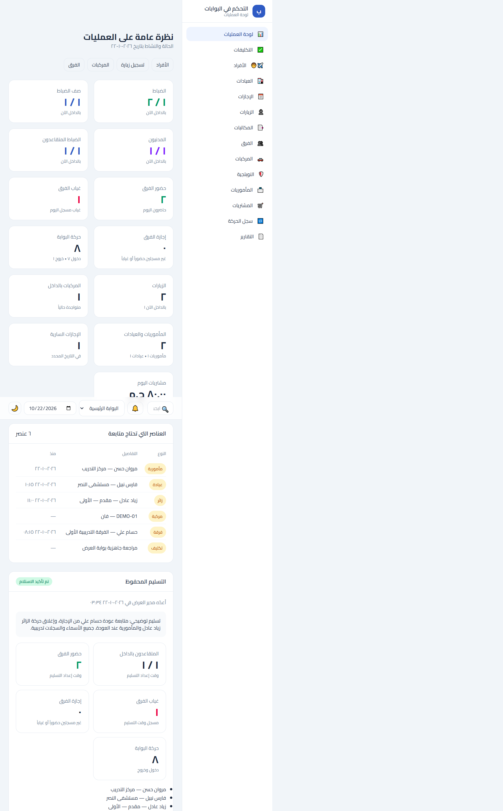

### الأفراد وحركة الدخول والخروج

تُضاف حركة الفرد عند وقوعها؛ لا يحتاج المشغّل إلى إثبات حضور كل القوة يوميًا. يظل الفرد ظاهرًا بالداخل إلى أن يُسجل خروجه. يعرض السجل أوقات الدخول والخروج، وسبب الحركة، والبوابة، ويتيح مراجعة تاريخ الفرد. وتشمل الفئات الضباط وصف الضباط والضباط المتقاعدين والمدنيين، مع مسار خاص للجندي العائد من الإجازة. للضباط المتقاعدين إجراء تمام يومي مستقل.

**مثال:** يسجل النظام دخول مروان حسن الساعة 07:45 وخروجه الساعة 12:30، بينما يظل كريم طارق مسجلًا بالداخل بسبب نوبتجيته. وفي بيانات العرض، سُجل تمام الضابط المتقاعد نادر فؤاد لليوم.

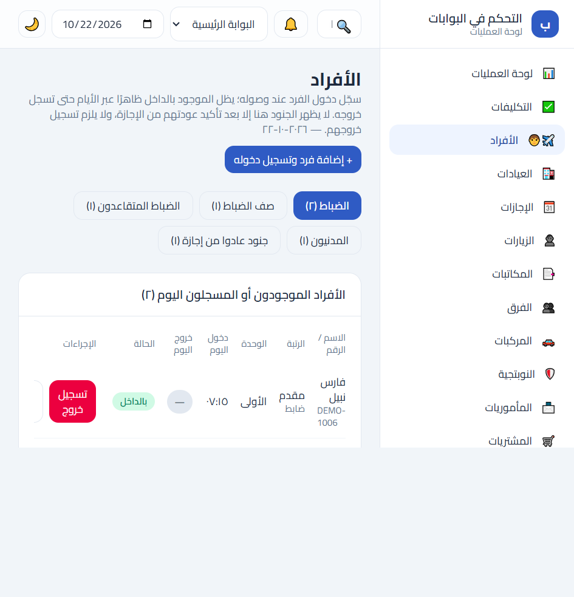

### الإجازات والعيادات

- **الإجازات:** يُسجل الفرد وسبب الإجازة وموعد العودة المتوقع. عند مغادرته يُسجل وقت الخروج، وعند رجوعه يُستخدم «تأكيد العودة» لتثبيت الوقت الفعلي وتحديث حركة الفرد. الإجازات التي لم تعد بعد تبقى قابلة للمتابعة.
- **العيادات:** يُسجل الفرد والحالة والجهة الطبية، ثم تُغلق الحالة بإجراء العودة. تظهر الحالة المفتوحة في لوحة اليوم حتى تُستكمل.

**مثال:** إجازة حسام علي بموعد عودة متوقع 22 أكتوبر الساعة 18:00، وحالة فارس نبيل لدى مستشفى النصر تبدأ 10:15 وتظل مفتوحة إلى حين تأكيد عودته.

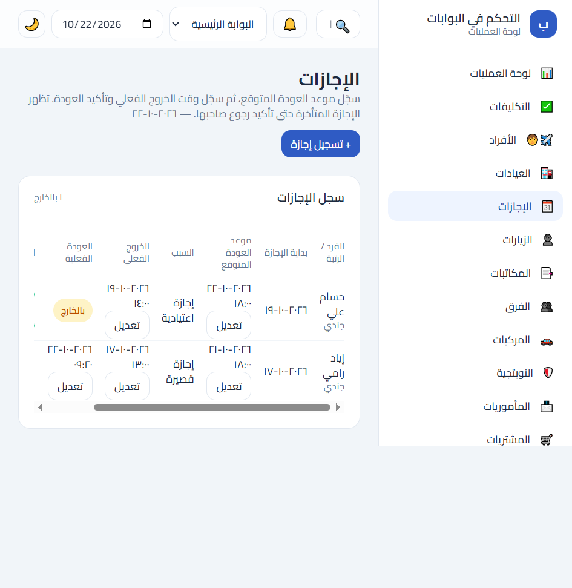

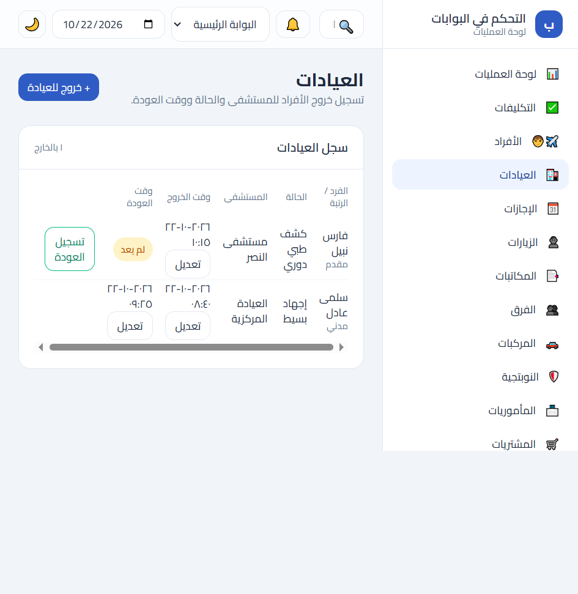

### الزيارات والمركبات

- **الزيارات:** تسجيل الاسم والرتبة من قائمة اختيار والوحدة وسبب الزيارة، ثم متابعة وقتي الدخول والخروج. تُحفظ أسماء الزائرين لتسهيل العثور عليهم في الزيارات التالية.
- **المركبات:** تعريف المركبة وسببها من الإدارة، وتعيين السائق والمرافق والأفراد الإضافيين لليوم، ثم تسجيل الحركة والوجهة عند الحاجة. يمكن كذلك تسجيل حركة مركبة غير معرفة مسبقًا.

**مثال:** زياد عادل، مقدم، مسجل بزيارة رسمية وما زال داخل الوحدة. تعرض المركبة DEMO-01 من نوع فان وسائقها ومرافقها وأحد أفراد طاقمها.

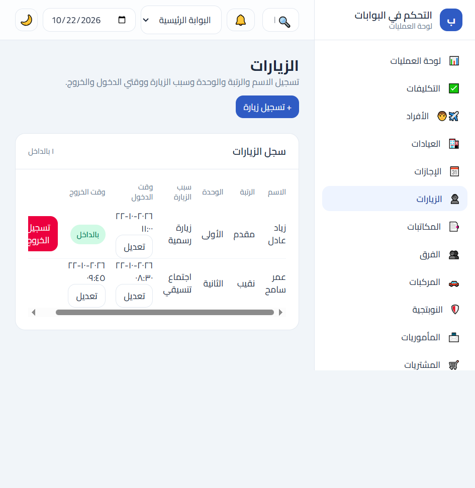

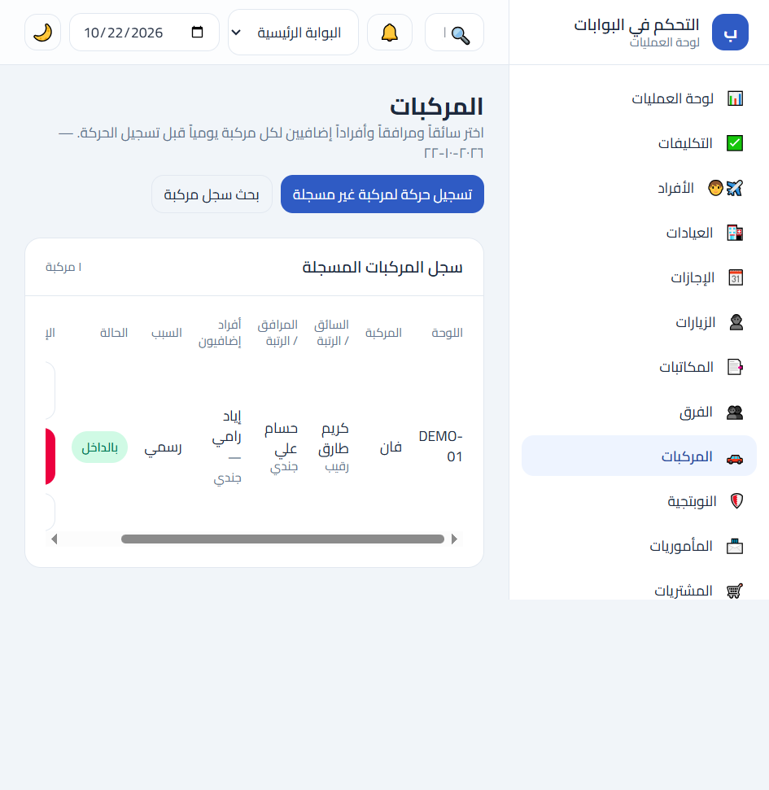

### الفرق والحضور والنوبتجيات

- **الفرق:** يحدد المدير اسم الفرقة وبداية مدتها ونهايتها وأفرادها. يسجل المشغّل الحضور والانصراف أو الغياب لكل فرد في اليوم. اليوم الذي لا يسجل فيه حضور أو غياب يُعامل كيوم إجازة، ويمكن فتح سجل الفرد لمراجعة مرات الحضور والغياب.
- **النوبتجيات:** تعيين فرد وصفته وفترة التكليف، لتظل صفته معروفة خلال الفترة بدل إعادة تسجيله كل يوم.

**مثال:** الفرقة التدريبية الأولى من 20 إلى 26 أكتوبر؛ حضر إياد رامي وانصرف، وحضر حسام علي دون تسجيل انصراف بعد، وسُجل غياب كريم طارق في المثال. كُلّف كريم كذلك بصفة ضابط نوبتجي خلال الفترة المحددة.

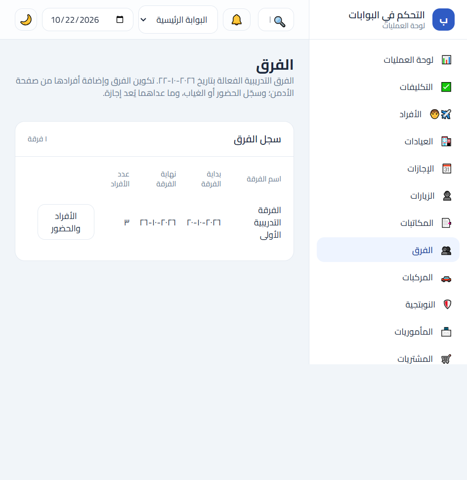

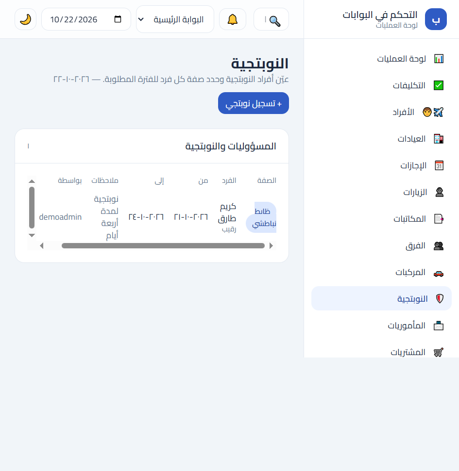

### المأموريات والمشتريات

- **المأموريات:** تسجيل الفرد والجهة والغرض ووقت الخروج؛ تبقى المأمورية جارية حتى تسجيل العودة.
- **المشتريات:** تسجيل الفرد والتاريخ والأصناف والأسعار والكميات، مع حساب الإجمالي وعرض سجلات الفترة.

**مثال:** مأمورية مروان حسن إلى مركز التدريب لاستلام مستندات. وفي المشتريات، سجل كريم طارق ثلاث وحدات مياه بسعر 10 جنيهات للوحدة ووحدتين من وجبة خفيفة بسعر 25 جنيهًا للوحدة؛ الإجمالي 80 جنيهًا.

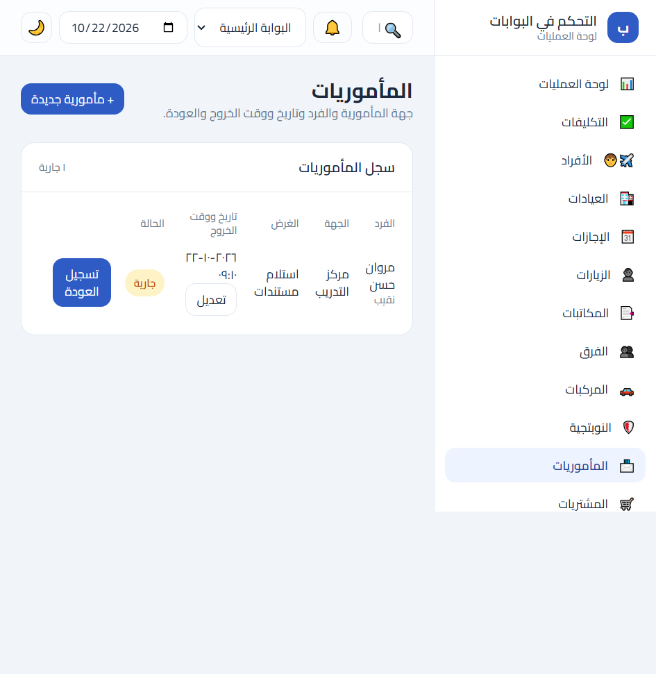

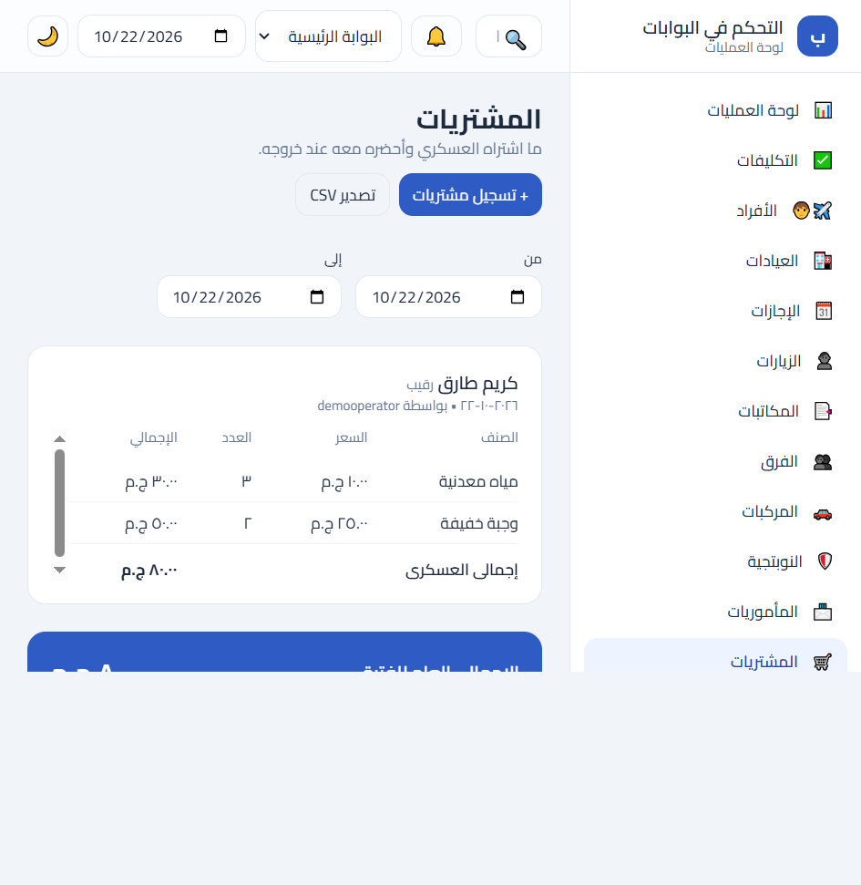

### المكاتبات والتكليفات والإشعارات

- **المكاتبات:** تسجيل الوارد والصادر والداخلي برقم مرجعي وجهات الإرسال والاستلام والقسم والموضوع والملخص وموعد المتابعة. تتوفر حالات متابعة ورسائل ومرفقات بصيغ مدعومة.
- **التكليفات:** يستطيع المدير إرسال مهمة لمستخدم أو أكثر، ويمكنه متابعة من أكد الاستلام.
- **الإشعارات:** تظهر للمستخدم الإجراءات والإشعارات الموجهة إليه، مع إمكان تعليمها كمقروءة.

**مثال:** مكاتبة واردة برقم DEMO-2026-014 من إدارة التدريب بخصوص جدول التدريب الأسبوعي، مسندة للمشغّل لمراجعتها قبل 24 أكتوبر. أُرسل كذلك تكليف بمراجعة جاهزية بوابة العرض.

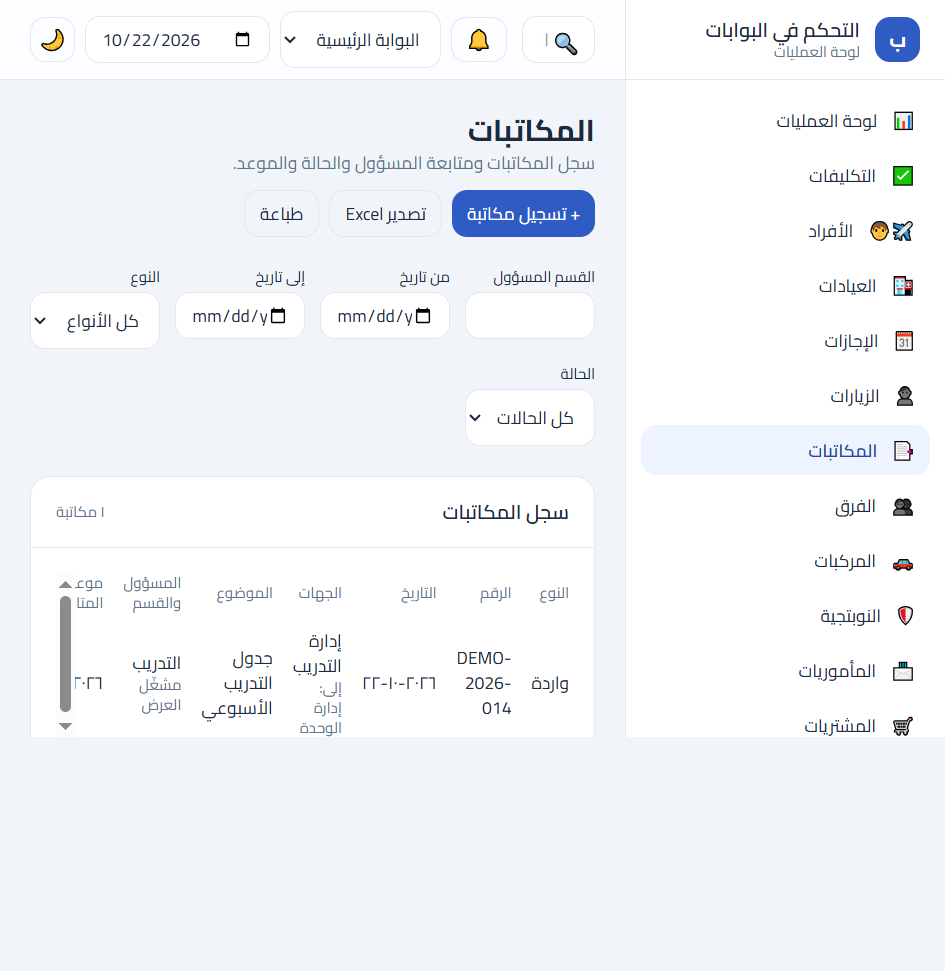

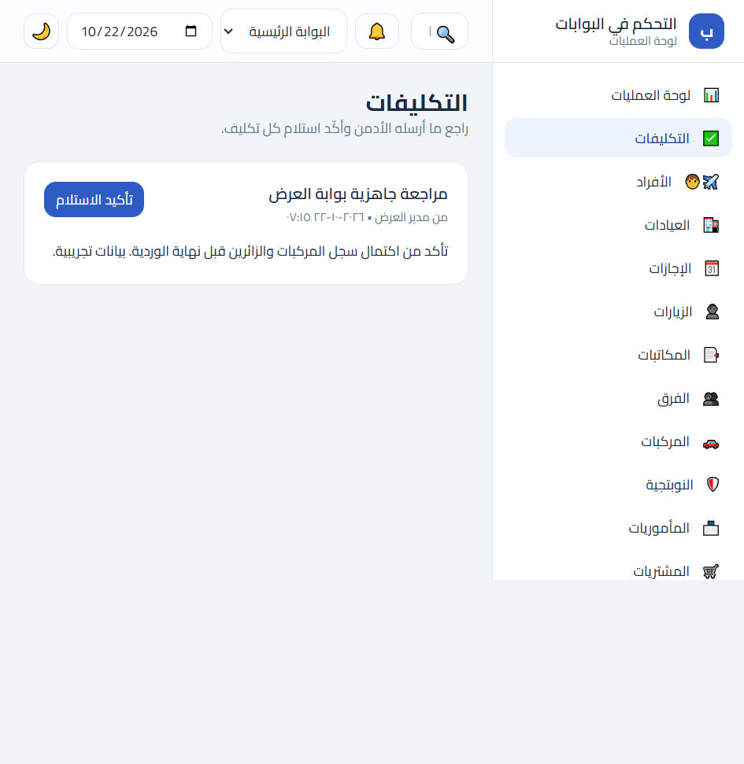

### التقارير وسجل الحركة وتعديل الوقت

يعرض سجل الحركة الوقائع حسب التاريخ، مع نوع الحركة والمرجع والبوابة والتوقيت والبيانات الإضافية. يجمع التقرير اليومي الإجازات والزيارات والعيادات وحركات الأفراد، وتتوفر تقارير للفترات وخيارات الطباعة والتصدير. يسمح إجراء تعديل الوقت بتصحيح التاريخ أو الساعة بعد التسجيل مع التحقق من ترتيب الأحداث وصلاحية المستخدم؛ المشغّل يعدل السجلات التي سجلها بنفسه، والمدير يستطيع تعديل السجلات المدعومة للمستخدمين.

**مثال:** إذا كان خروج مروان حسن مسجلًا بالخطأ في وقت غير صحيح، يستطيع المستخدم المخوّل تصحيحه من سجل الحركة؛ وتظهر الحركة المصححة في التقرير.

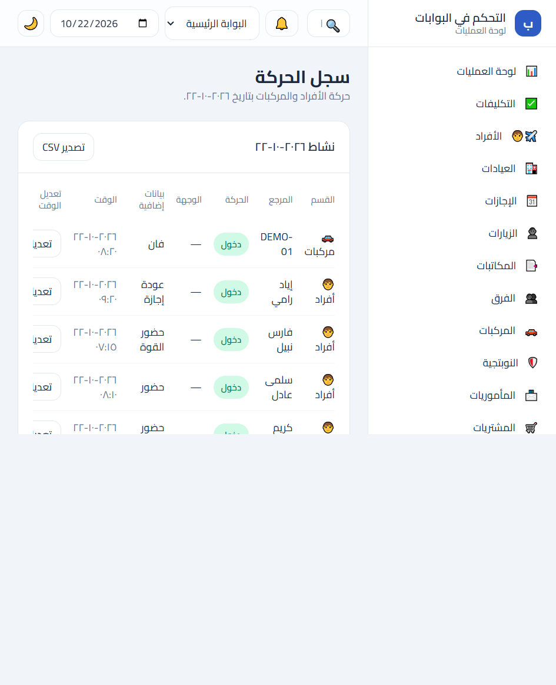

### الواجهة وسهولة الاستخدام

الواجهة عربية من اليمين إلى اليسار، وتعمل على المتصفح وتطبيق Windows. تشمل البحث العام، واختيار البوابة والتاريخ، والوضع الداكن مع حفظ التفضيل، وقائمة جانبية تناسب الشاشات الصغيرة. وتتيح صفحة التقرير اليومي عرض التقرير حسب التاريخ المحدد وطباعته.

**مثال:** يختار المشغّل البوابة والتاريخ من الشريط العلوي، ثم يبحث عن اسم فرد أو لوحة مركبة للوصول إلى القسم المعني.

### الإدارة والصلاحيات والقوائم والنسخ الاحتياطي

لوحة الإدارة مخصصة للحسابات الإدارية، وتوفر:

- إضافة الأفراد والمركبات وتعديل بياناتهم.
- إنشاء الفرق وإدارة العضوية والتكليفات.
- إعداد قوائم الوحدات والبوابات وأسباب الزيارات ووجهات الحركة.
- إنشاء حسابات المستخدمين، وتعيين دور مدير أو مشغّل، وإدارة التفعيل وكلمة المرور.
- إنشاء نسخة احتياطية واستعراض النسخ المتاحة والاستعادة. الاستعادة تستبدل البيانات الحالية، ولذلك ينشئ النظام نسخة أمان قبل تنفيذها.

**مثال:** المدير يضيف وحدة جديدة إلى القائمة، وينشئ حساب مشغّل، ثم يسند إليه تكليفًا ويراجع تأكيد استلامه.

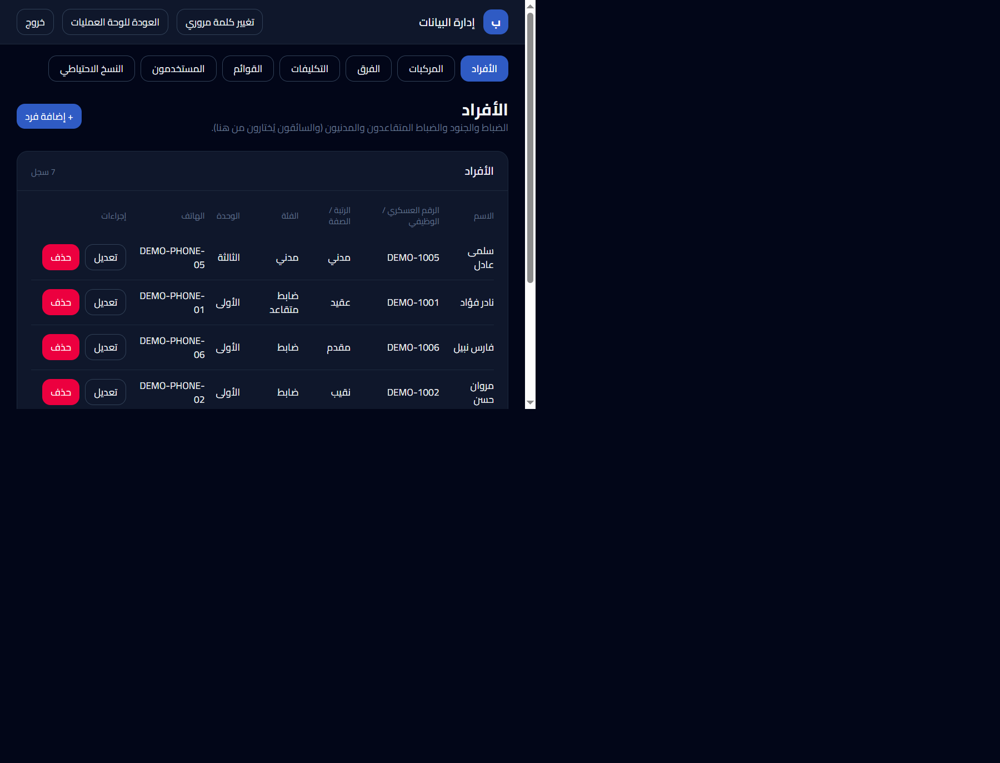

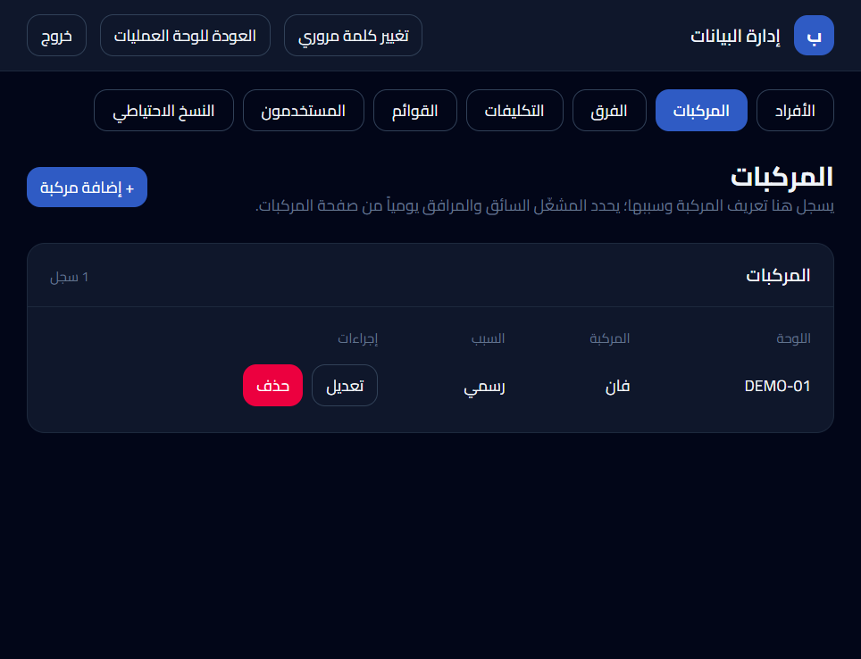

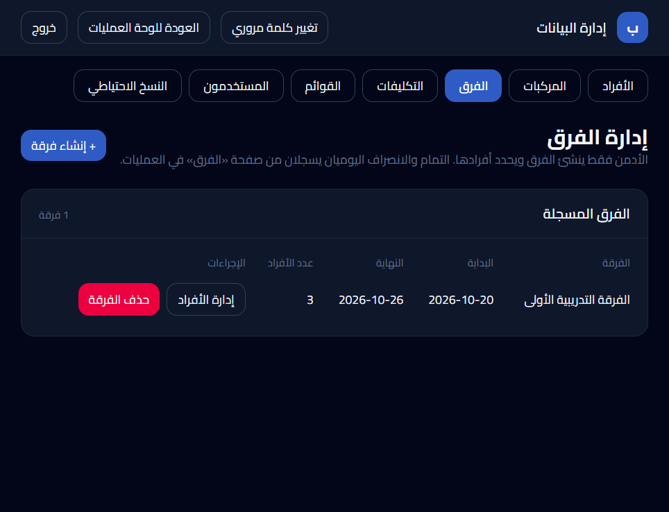

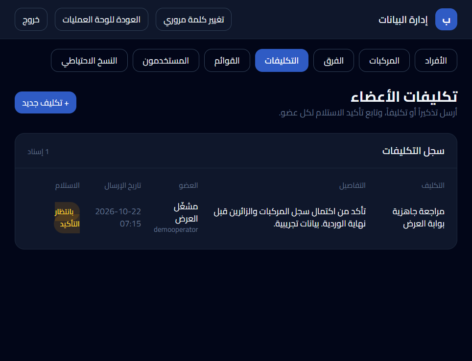

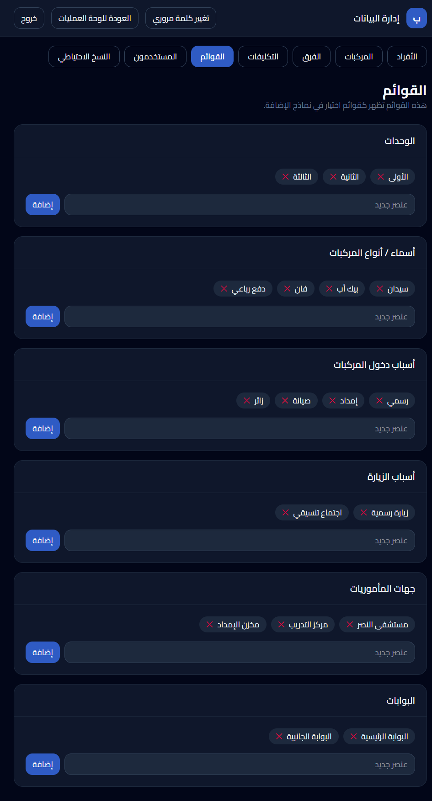

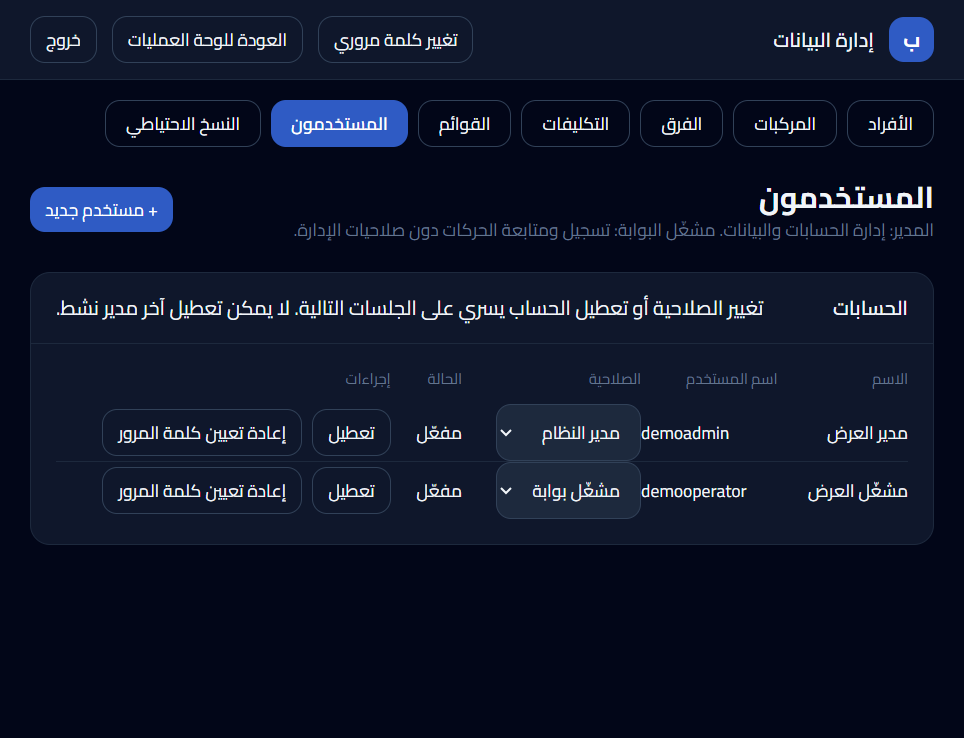

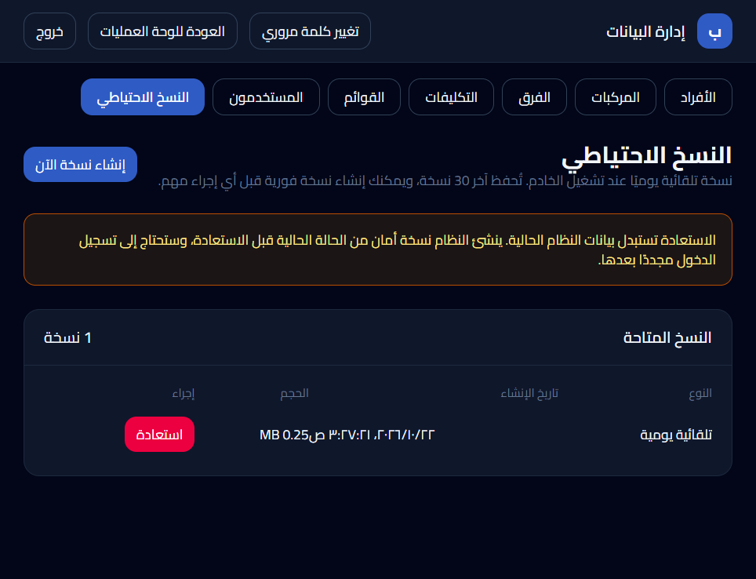

## مسار عرض مقترح للإدارة

يمكن تقديم النظام خلال نحو 7–10 دقائق بهذا الترتيب:

1. ابدأ بلوحة العمليات ووضّح ملخص اليوم والعناصر المفتوحة.
2. افتح سجل الأفراد، ثم الزيارات والمركبات لعرض تفاصيل الحركة.
3. انتقل إلى الإجازات والعيادات، وبيّن أهمية تسجيل العودة لإغلاق الحالة.
4. اعرض حضور الفرقة والنوبتجية والمأمورية.
5. افتح المكاتبات والتكليفات والمشتريات، ثم اختم بالتقرير اليومي وسجل الحركة.
6. اعرض لوحة الإدارة والنسخ الاحتياطي إذا كان الحضور معنيًا بإدارة النظام.

كل الصور والأسماء في هذا المستند توضيحية. قبل أي عرض على بيانات حقيقية، ينبغي استخدام حسابات مخوّلة والالتزام بسياسة الجهة للبيانات والنسخ الاحتياطية.

## مستندات ذات صلة

- [دليل المستخدم](./دليل-المستخدم.md) للتعليمات التشغيلية التفصيلية.
- [دليل المسؤول والتشغيل](./دليل-المسؤول-والتشغيل.md) للحسابات والإعداد والتشغيل والنسخ الاحتياطي.
- [README المشروع](../README.md) للتعريف والتشغيل السريع.
